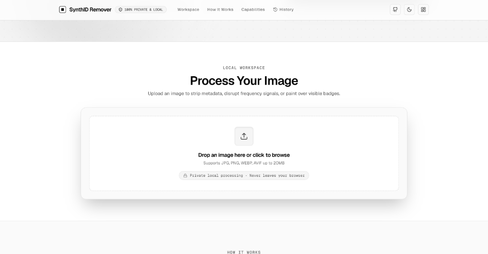

<p align="center">
  
</p>

<h1 align="center">Realtime SynthID Remover</h1>

<p align="center">
  <strong>🔒 Remove AI Watermarks, C2PA Content Credentials & Google SynthID Signals 100% Locally.</strong>
</p>

<p align="center">
  <a href="https://satiricalguru.github.io/synthid-remover/"></a>
  <a href="#-license"></a>
  <a href="https://nextjs.org"></a>
  <a href="https://www.typescriptlang.org/"></a>
  <a href="#"></a>
</p>

---

## 🌐 Live Website

🌐 **Try the Live Application**: [https://satiricalguru.github.io/synthid-remover/](https://satiricalguru.github.io/synthid-remover/)

---

## 📸 Screenshots

<p align="center">
  
  <br />
  <em>Realtime Reverse Alpha Blending & SynthID frequency signal disruption scanner.</em>
</p>

<!-- 
  📸 USER SCREENSHOTS PLACEHOLDER
  Add your website screenshots below when ready:
  <p align="center">
    
  </p>
  <p align="center">
    
  </p>
-->

---

## 🌟 Overview

**Realtime SynthID Remover** is a privacy-first web application designed to erase visible AI watermarks, wipe embedded metadata headers, and neutralize spatial frequency watermarks (such as Google SynthID) completely on your local device.

Unlike cloud converters, **your images never touch a remote server**. Everything is processed in local memory using standard Web APIs, Sharp pixel matrices, and mathematically exact Reverse Alpha Blending algorithms.

---

## ✨ Key Features

- **⚡ Reverse Alpha Blending Engine**: Powered by pre-computed 48px/96px Gemini alpha maps and catalog specifications to mathematically reconstruct original pixels:
  $$\text{original} = \frac{\text{watermarked} - \alpha \times \text{logo}}{1 - \alpha}$$
- **🛡️ 100% Private Local Processing**: Zero network uploads. All image operations execute on your CPU/GPU inside standard client/server Web runtimes.
- **📜 Metadata & C2PA Wiping**: Completely wipes EXIF tags, XMP schemas, ICC color profiles, and C2PA Content Credentials attached by ChatGPT, Midjourney, and Gemini.
- **🌊 SynthID Frequency Signal Disruption**: Resamples spatial DCT phase bins using 100.5% Lanczos-3 matrix scaling and microscopic dither jitter to neutralize imperceptible frequency-domain watermarks.
- **🖌️ Interactive Brush Inpainting**: Interactive canvas with soft edge falloff for manually painting over complex visual badges.
- **📊 Local Job History & Telemetry**: Track all local processing runs, execution times, and dimension telemetry in browser storage (`localStorage`).

---

## 🛠️ Tech Stack

| Component | Technology |
| :--- | :--- |
| **Framework** | [Next.js 14](https://nextjs.org/) (App Router) |
| **Language** | [TypeScript](https://www.typescriptlang.org/) |
| **Styling** | [Tailwind CSS](https://tailwindcss.com/) |
| **Image Processing** | [Sharp](https://sharp.pixelplumbing.com/) & [`@pilio/gemini-watermark-remover`](https://github.com/GargantuaX/gemini-watermark-remover) |
| **Deployment** | [GitHub Pages](https://satiricalguru.github.io/synthid-remover/) (GitHub Actions) |

---

## 🚀 Quick Start

### Prerequisites
- Node.js 18.x or higher
- npm, pnpm, or yarn

### Installation

1. Clone the repository:
   ```bash
   git clone https://github.com/satiricalguru/synthid-remover.git
   cd synthid-remover
   ```

2. Install dependencies:
   ```bash
   npm install --legacy-peer-deps
   ```

3. Start the development server:
   ```bash
   npm run dev
   ```

4. Open [http://localhost:3000](http://localhost:3000) in your browser.

---

## 🖼️ How It Works

```
[ Input Image ] ──► [ 1. Reverse Alpha Blending ] ──► Erases visible Gemini sparkle badges
                 ──► [ 2. Metadata Stripper ]     ──► Removes EXIF, XMP & C2PA tags
                 ──► [ 3. Frequency Disruption ] ──► Resamples DCT bins & injects dither
                 ──► [ Cleaned Export ]
```

---

## 📄 License

Distributed under the **MIT License**. See [`LICENSE`](LICENSE) for more information.

---

<p align="center">
  Crafted with ❤️ for privacy and data ownership.
</p>
