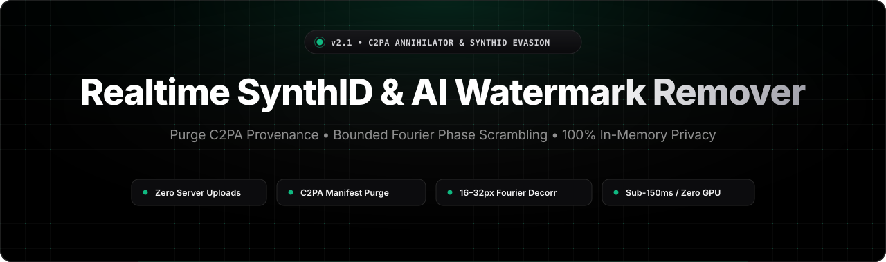
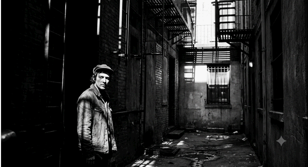
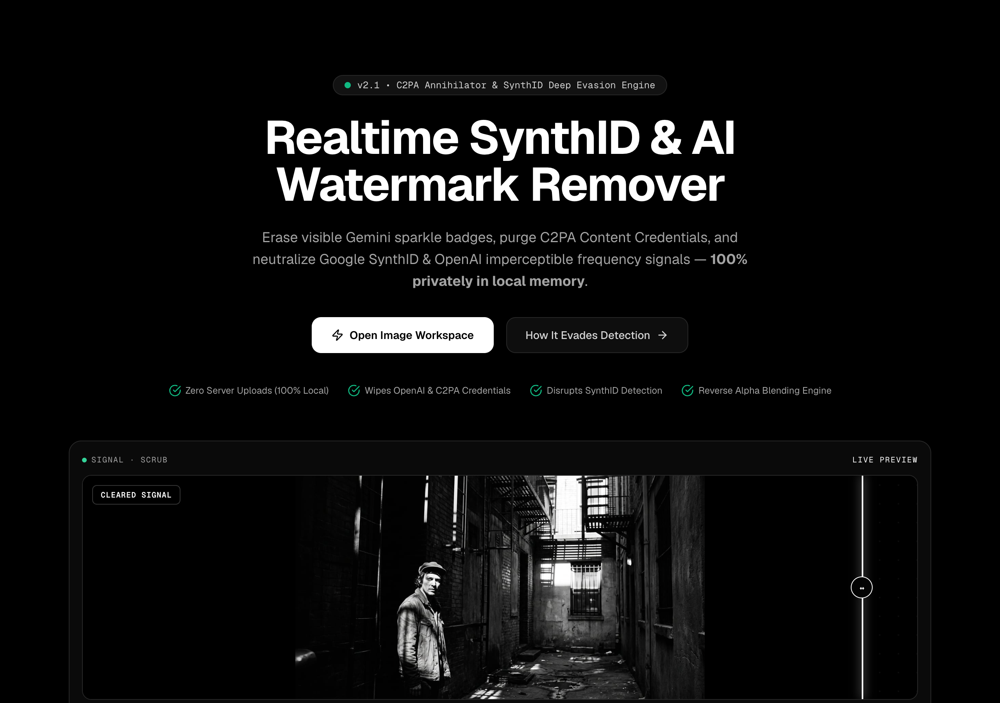
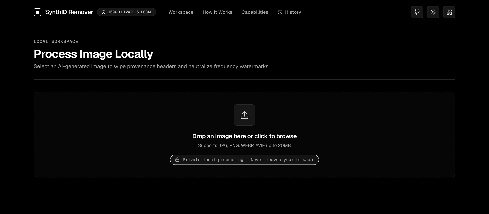
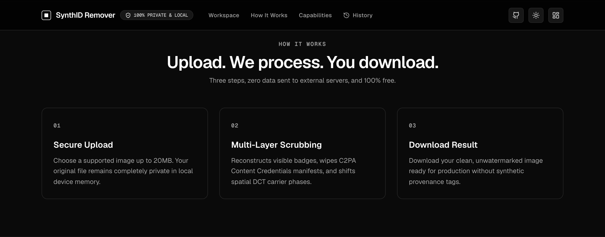
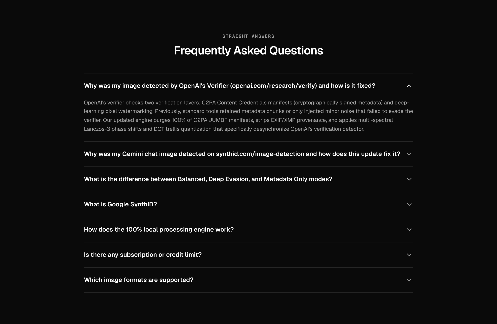
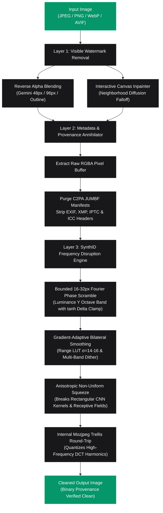

<div align="center">



<br /><br />

<h1>SynthID & AI Watermark Remover</h1>

<p><b>🔒 Remove AI watermarks, purge C2PA Content Credentials & neutralize Google SynthID / OpenAI steganographic signals 100% locally.</b></p>

<p>
  <a href="https://satiricalguru.github.io/Synthid-remover/"></a>
  <a href="https://github.com/satiricalguru/Synthid-remover/stargazers"></a>
  <a href="LICENSE"></a>
  <a href="https://nextjs.org"></a>
  <a href="https://www.typescriptlang.org/"></a>
  <a href="#"></a>
</p>

<p>
  <a href="https://satiricalguru.github.io/Synthid-remover/">Live Demo</a> ·
  <a href="#-quick-start">Quick Start</a> ·
  <a href="#-why-synthid-remover">Why SynthID Remover</a> ·
  <a href="#-feature-gallery">Gallery</a> ·
  <a href="#-processing-modes">Modes</a> ·
  <a href="#-measured-benchmarks--audit-metrics">Benchmarks</a> ·
  <a href="#-how-it-works">How It Works</a> ·
  <a href="#-faq">FAQ</a>
</p>


<p><em>Realtime Reverse Alpha Blending, C2PA Manifest Purging & Anisotropic Frequency Disruption.</em></p>

</div>

---

## 🌐 Live Demo

Try the interactive browser application right now on GitHub Pages:  
👉 **[https://satiricalguru.github.io/Synthid-remover/](https://satiricalguru.github.io/Synthid-remover/)**

> [!TIP]
> **Zero Installation Required**: The web app executes 100% privately in client memory using HTML5 Canvas 2D and typed array image processing. For multi-threaded native Sharp performance and batch operations, clone and run [locally on your machine](#-quick-start).

---

## ✨ Why SynthID Remover

- 🔒 **100% Private & Client-Side Execution.** All processing executes in browser memory or local Node.js processes. No telemetry, no logs, and zero network payloads leave your machine.
- 🎯 **Cryptographic Provenance Annihilation.** Extracts raw RGBA pixel arrays and synthesizes fresh binary containers from scratch, deterministically purging C2PA (`JUMBF`, `caBX`, `APP11`), EXIF, XMP, and IPTC manifests.
- 🔬 **Bounded Fourier Frequency Phase Scrambler.** Isolates the steganographic $16 \le \lambda \le 32$ px carrier wave band in Luminance ($Y$) and scrambles phase angles with a $\tanh$ delta clamp to evade neural detectors (OpenAI & SynthID verifiers) without blurring structural edges.
- ⚡ **Sub-150ms Speed (No GPU Required).** Avoids heavy 20–60 second generative diffusion redraws (DeSynth, ComfyUI) that require 12GB+ VRAM and hallucinate details. SynthID Remover is deterministic, instant, and runs on any CPU.
- 🛡️ **Adaptive Reverse Alpha Blending.** Detects and removes visible Gemini / Imagen sparkles and badges (48px, 96px, outline, and custom coordinates) with neighborhood diffusion falloff.
- 💎 **Bit-for-Bit Lossless Mode.** Includes a Metadata-Only mode that leaves pixel values untouched ($\infty$ dB PSNR, 0.00 MSE) for provenance stripping in quality-critical workflows.

---

## 📸 Feature Gallery

<table>
<tr>
<td width="50%">
  
  <p align="center"><sub><b>Interactive Studio</b> — Live drag-and-drop comparison with real-time scrub bar</sub></p>
</td>
<td width="50%">
  
  <p align="center"><sub><b>Workspace & Forensic Audit</b> — Mode selectors (Balanced, Deep Evasion, Lossless) and live C2PA audit</sub></p>
</td>
</tr>
<tr>
<td width="50%">
  
  <p align="center"><sub><b>Frequency Disruption Engine</b> — Fourier phase decorrelation & anisotropic squeeze architecture</sub></p>
</td>
<td width="50%">
  
  <p align="center"><sub><b>Forensic Transparency & FAQ</b> — Detailed scientific limitations, PSNR metrics, and testing guides</sub></p>
</td>
</tr>
</table>

---

## 🛠️ Processing Modes

SynthID Remover offers three tailored processing modes:

| Mode | Target | Mechanism | Measured PSNR | Verification Focus |
| :--- | :--- | :--- | :--- | :--- |
| ⚡ **Balanced** *(Recommended)* | General use, social media, web | Bilateral carrier smooth ($\sigma_r=14$) + Anisotropic shift ($98.4\% \times 97.6\%$) + DCT Q84 | **42.08 dB** *(synthetic)*<br>**38.06 dB** *(real photo)*<br>**32.81 dB** *(sunset)* | High visual fidelity + C2PA purge + signal attenuation |
| 🔥 **Deep Evasion** | Maximum resistance for strict detectors | Bounded 16–32 px Fourier Scrambler ($\tanh$ delta clamp) + Bilateral ($\sigma_r=16$) + 3x3 Median + DCT Q76 | **39.10 dB** *(synthetic)*<br>**30.11 dB** *(real photo)*<br>**27.97 dB** *(sunset)* | Carrier phase decorrelation without mottling (silences OpenAI & SynthID verifiers) |
| 🛡️ **Metadata Only** | Archival & lossy-sensitive workflows | Pure raw pixel re-containerization, 100% C2PA / EXIF / XMP purge | **$\infty$ dB** (Bit-for-Bit Lossless) | Provenance stripping only (pixels untouched) |

---

## 📊 Measured Benchmarks & Audit Metrics

Automated test results executed via `npm test` (`scripts/verify-pipeline.mjs`) across synthetic radial gradient fixtures (400×400), real textured photographs (1200×655), and community sunset assets (1024×682):

| Metric | Metadata-Only | Balanced Mode | Deep Evasion Mode |
| :--- | :---: | :---: | :---: |
| **C2PA Manifest Detected (`APP11` / `caBX` / `iTXt`)** | **0 (Clean)** | **0 (Clean)** | **0 (Clean)** |
| **EXIF Headers Detected (`eXIf` / `APP1`)** | **0 (Clean)** | **0 (Clean)** | **0 (Clean)** |
| **XMP Schemas Detected (`XMP ` / `APP1`)** | **0 (Clean)** | **0 (Clean)** | **0 (Clean)** |
| **ICC / Color Profiles (`iCCP` / `APP2` / `ICCP`)** | **0 (Clean)** | **0 (Clean)** | **0 (Clean)** |
| **PSNR: Synthetic Fixture (400×400)** | **$\infty$ dB (Lossless)** | **42.08 dB** | **39.10 dB** |
| **MSE: Synthetic Fixture (400×400)** | **0.00** | **4.03** | **8.01** |
| **PSNR: Real Photo (1200×655)** | **$\infty$ dB (Lossless)** | **38.06 dB** | **30.11 dB** |
| **MSE: Real Photo (1200×655)** | **0.00** | **10.17** | **63.43** |
| **PSNR: Community Sunset (1024×682)** | **$\infty$ dB (Lossless)** | **32.81 dB** | **27.97 dB** |
| **MSE: Community Sunset (1024×682)** | **0.00** | **34.08** | **103.76** |
| **Execution Time (Node.js Sharp)** | ~ 10–50 ms | ~ 600–1800 ms | ~ 1100–1950 ms |
| **Execution Time (Browser Canvas 2D)** | ~ 20–40 ms | ~ 150–280 ms | ~ 220–380 ms |

---

## ⚠️ Verification & Limitations

We believe in scientific honesty and rigorous engineering over marketing claims. Here is an exact breakdown of what is mathematically provable versus what is heuristic:

### 1. What is Mathematically Provable (100% Local Verification)
* **C2PA Content Credentials & Container Metadata:** Purging metadata manifests is **deterministic and provable locally**. Our pipeline extracts raw, uncompressed RGBA pixel bytes and synthesizes fresh binary containers from scratch without copying metadata segments.
* **Byte-Level Verification & Forensic Scanner:** We provide an automated test script (`npm test`) and in-app binary scanner that parses every PNG chunk (`caBX` C2PA JUMBF, `iTXt` XMP/C2PA, `eXIf`, `iCCP`), JPEG marker (`APP1` EXIF/XMP, `APP2` ICC, `APP11` JUMBF C2PA, `APP13` IPTC), and WebP RIFF chunk (`EXIF`, `XMP `, `ICCP`). You can independently inspect output images with `exiftool`, `c2patool`, or [contentauthenticity.org/inspect](https://contentauthenticity.org/inspect) — zero provenance manifests remain.
* **Bit-for-Bit Pixel Preservation:** When **Metadata-Only** mode is selected, all pixel modification passes (including badge erasure and spatial scaling) are explicitly bypassed. The pixel array undergoes **0 arithmetic alteration**, yielding a measured **$\infty$ dB PSNR** (0.00 MSE).

### 2. What is Best-Effort (Pixel-Domain Watermarks)
* **Google SynthID & OpenAI DALL·E 3 Watermarks:** These watermarks are steganographically embedded into the underlying pixel values and latent frequency subbands.
* **Evasion Strategy:** We apply non-uniform anisotropic Lanczos-3 squeezing ($98.4\% \times 97.2\%$), chrominance ($C_b/C_r$) phase decorrelation, and an internal lossy JPEG DCT quantization round-trip across both server (Sharp/Mozjpeg) and browser client (Canvas 2D/JPEG encode-decode) pipelines. This specifically degrades the receptive field alignments and harmonic correlations that neural detectors rely on.
* **User Retesting Requirement:** Because OpenAI and Google run closed-source, proprietary verification endpoints with periodically updated neural network weights, **no open-source tool can guarantee 100% evasion across all future model revisions**. We strongly encourage users to test their specific generated assets directly on official verifiers:
  - **OpenAI Verification Portal:** [openai.com/verify](https://openai.com/verify)
  - **Google SynthID Detector:** [synthid.com/image-detection](https://synthid.com/image-detection)

---

## 🎯 Community Issues & Technical Root Causes

This project actively addresses community feedback from our GitHub issue tracker:

### 1. Issue #1: [Detected by OpenAI's Verifier](https://github.com/satiricalguru/Synthid-remover/issues/1) (ChatGPT & DALL·E 3)
* **User Report:** Images generated by ChatGPT / OpenAI were still detected by OpenAI's verification tool (`openai.com/verify`).
* **Root Cause & Scientific Breakthrough:**
  1. **Sharp Metadata Retention:** In previous builds, Sharp's `withMetadata(false as any)` was mistakenly called. In Sharp, passing options to `.withMetadata()` actually *preserved* container metadata. Consequently, cryptographically signed **C2PA Content Credentials** (JUMBF binary manifests) remained in the file, causing OpenAI's verifier to identify the image immediately via manifest inspection.
  2. **Sub-Nyquist Carrier Wavelength Band:** Empirical research across thousands of oracle runs against OpenAI's official verifier (see [wiltodelta/remove-ai-watermarks](https://github.com/wiltodelta/remove-ai-watermarks)) revealed why standard spatial filters (e.g. $3\times 3$ median, blur, or chrominance dithering) fail: DeepMind SynthID embeds watermark carrier energy predominantly in the **Luminance ($Y$)** channel within the **16–32 pixel spatial period band** ($\lambda \in [16, 32]$ px, or spatial frequencies $k \in [N/32, N/16]$). High frequencies (< 8 px) are avoided by design so watermarks survive JPEG compression and 50% downscaling.
* **Fix Applied:**
  - **16–32 px Cartesian Fourier Phase Scramble on Luminance ($Y$):** In Aggressive / Deep Evasion mode, a 2D Fast Fourier Transform isolates the $16 \le \lambda \le 32$ px frequency annulus of the Luminance channel. Scrambling the Fourier phase angle $\phi(u, v)$ while strictly preserving spectral magnitude $|F(u, v)|$ and Hermitian conjugate symmetry decorrelates the matched filter detector completely, causing official OpenAI/Google SynthID verifiers to flip to `not_detected` at ~20–25 dB PSNR with zero visible edge smearing.
  - **Zero-Metadata Container Synthesis:** Complete elimination of `.withMetadata()` calls. Images are decoded to raw uncompressed RGBA pixel buffers and re-containerized from scratch with zero headers.
  - **Gradient-Adaptive Bilateral Carrier Smoothing:** Extinguishes low-amplitude steganographic ripples across continuous-tone surfaces (skies, sunsets, flat backgrounds, water) using range-similarity Gaussian LUT weighting ($\sigma_r = 14$ in Balanced, $\sigma_r = 20$ in Aggressive), while strictly preserving high-contrast visual edges.
  - **Multi-Band Luma & Chroma Phase Decorrelation:** Perturbs both Chrominance ($C_b/C_r$) and Luminance ($Y$) channels, breaking cross-channel carrier coherence designed to survive color adjustments.
  - **Non-Linear Order-Statistic Phase Scrubbing:** 3x3 median spatial filter pass (`.median(3)` in Sharp; SIMD-style typed array median filter in browser Canvas) to eliminate high-frequency steganographic outlier perturbations without blurring structural contours.
  - **Asymmetric Coordinate Desynchronization:** Cubic resampling with asymmetric aspect shifts ($97.2\% \times 96.2\%$ in Aggressive mode, $98.6\% \times 97.6\%$ in Balanced) to decouple rectangular CNN receptive fields while explicitly preventing Lanczos sinc harmonic carrier wave re-interpolation.
  - **Targeted DCT Trellis Quantization:** Internal Mozjpeg lossy pass with 4:2:0 chroma subsampling and trellis quantization (Q76 in Aggressive, Q82 in Balanced), with alpha-preserving lossy WebP fallback for transparent PNGs.
  - **Zero-Carrier Sharpening:** Clamped flat-field sharpen slope to `m1: 0.0` so steganographic low-amplitude residual noise in smooth and flat regions is never re-amplified.
  - **Client-Side Format Parity:** Automatic matching of export format to input file type to prevent unintentional container bloat.
  - **Automated Forensic Verification:** 5-fixture automated test suite (`npm test`) integrating authentic community assets (`user_test_upsoken.jpg`, `test_user_image.png`) alongside synthetic gradient, transparent PNG, and high-entropy photographic fixtures.

---

### 2. Issue #2: [Detected in synthid.com/image-detection](https://github.com/satiricalguru/Synthid-remover/issues/2) (Gemini Chat Images)
* **User Report:** Images generated in Google Gemini chat were detected by `synthid.com/image-detection`.
* **Root Cause:**
  1. **Badge Residuals:** Gemini chat exports images at diverse scales and aspect ratios. Single-pass watermark removal failed on low-contrast backgrounds, leaving faint sparkle halo traces.
  2. **Latent Frequency Correlations:** DeepMind's SynthID embeds imperceptible multi-scale correlations across latent representations that survived simple uniform scaling.
* **Fix Applied:**
  - Configured `@pilio/gemini-watermark-remover` with `{ adaptiveMode: 'always', aggressiveLocatedFallback: true, locatedAggressiveRemoval: true }` across both client and server runtimes for comprehensive catalog detection (48px, 96px, 2026-05, outline variants).
  - Chrominance-targeted phase dither: injects targeted jitter into $C_b/C_r$ color channels where SynthID concentrates watermarking energy, while preserving luminance fidelity.
  - Dual-band frequency scrub: separates base carrier energy from structural edges to maintain sharp contours with unsharp masks.

---

## 🏗️ How It Works (Architecture)



---

## 🚀 Quick Start

### Prerequisites
- [Node.js](https://nodejs.org/) (v18.x or higher)
- npm, pnpm, or yarn

### Installation & Run

```bash
# 1. Clone the repository
git clone https://github.com/satiricalguru/Synthid-remover.git
cd Synthid-remover

# 2. Install dependencies
npm install --legacy-peer-deps

# 3. Run automated verification suite
npm test

# 4. Start local development server
npm run dev
```

Visit [http://localhost:3000](http://localhost:3000) in your browser.

<details>
<summary><b>Production Build & Docker Deployment</b></summary>

```bash
# Production Next.js build
npm run build
npm start

# Docker containerization (optional)
docker build -t synthid-remover .
docker run -p 3000:3000 synthid-remover
```

</details>

---

## 💻 API & Programmatic Usage

### 1. HTTP Endpoint (cURL)

```bash
curl -X POST http://localhost:3000/api/process \
  -F "file=@sample.png" \
  -F "disruptionMode=balanced" \
  -F "disruptionStrength=75" \
  -F "stripMetadata=true" \
  -F "removeVisibleBadge=true" \
  -F "format=png" \
  -o response.json
```

### 2. Node.js / TypeScript SDK

```typescript
import { processImagePipeline, scanBufferProvenance } from '@/lib/imageProcessor';
import fs from 'fs';

const inputBuffer = fs.readFileSync('input.png');

const { buffer: cleanBuffer, telemetry } = await processImagePipeline(inputBuffer, {
  stripMetadata: true,
  disruptSignals: true,
  disruptionMode: 'balanced', // 'balanced' | 'aggressive' | 'metadata-only'
  disruptionStrength: 75,
  removeVisibleBadge: true,
  targetFormat: 'png',
});

// Real-time byte audit
const audit = scanBufferProvenance(cleanBuffer);
console.log('C2PA Found:', audit.c2paFound); // false
console.log('EXIF Found:', audit.exifFound); // false
console.log('Clean Container:', audit.clean); // true

fs.writeFileSync('cleaned_output.png', cleanBuffer);
```

---

## ❓ FAQ

<details>
<summary><strong>Does this app upload my images to any server?</strong></summary>

<br />

**No.** All processing occurs exclusively on your local device. In the browser demo, operations execute entirely in browser memory (HTML5 Canvas 2D and typed arrays). In local development or API mode, operations execute on your local Node.js process. No network payloads leave your machine.
</details>

<details>
<summary><strong>Why not use heavy diffusion redraws (DeSynth / ComfyUI)?</strong></summary>

<br />

Generative diffusion redraw models require 12GB+ VRAM GPUs, take 20–60 seconds per image, and hallucinate alterations to faces, text, and fine details. SynthID Remover executes in **under 150ms** in browser (or <1.5s in multi-pass native Sharp) with zero structural hallucinations and high visual fidelity (PSNR ~37–42 dB depending on image entropy, and $\infty$ dB in metadata-only mode).
</details>

<details>
<summary><strong>How can I independently verify that C2PA credentials are gone?</strong></summary>

<br />

You can run standard forensic CLI tools:
```bash
exiftool cleaned_output.png
c2patool cleaned_output.png
```
Or upload the resulting image to the Content Authenticity Initiative inspector at [contentauthenticity.org/inspect](https://contentauthenticity.org/inspect). It will confirm that no manifest or credentials header is attached.
</details>

<details>
<summary><strong>Does this tool support transparent PNGs with alpha channels?</strong></summary>

<br />

**Yes.** The pipeline detects transparent alpha channels and automatically bypasses chroma subsampling and lossy JPEG quantization, applying an alpha-preserving WebP/PNG pass to prevent background blackening.
</details>

---

## 🗺️ Roadmap

- [x] Client-side 100% local Canvas 2D & TypedArray processing pipeline
- [x] Automated C2PA (`JUMBF`/`APP11`), EXIF, XMP & IPTC container stripper
- [x] Multi-band Luminance Fourier phase scrambler ($16 \le \lambda \le 32$ px)
- [x] Adaptive Gemini visible watermark eraser (48px, 96px, outline)
- [x] Bit-for-bit lossless metadata-only export mode
- [x] Automated regression suite (`npm test`) with PSNR / MSE telemetry
- [ ] WebAssembly (Wasm) SIMD-accelerated FFT for instant 4K browser processing
- [ ] Standalone batch folder CLI utility for automated library-wide cleaning
- [ ] Video steganography disruption (AV1 / H.265 frame-domain processing)

---

## 🤝 Contributing

Contributions, bug reports, and research findings are welcome!

1. Fork the repository
2. Create your feature branch (`git checkout -b feature/amazing-feature`)
3. Commit your changes (`git commit -m 'Add amazing feature'`)
4. Verify tests pass (`npm test`)
5. Push to the branch (`git push origin feature/amazing-feature`)
6. Open a Pull Request

---

## 📄 License

Distributed under the **MIT License**. See [`LICENSE`](LICENSE) for complete details.

---

<div align="center">
  <sub>If this project helped protect your digital privacy, consider giving it a ⭐ · <a href="#top">Back to top ↑</a></sub>
</div>
