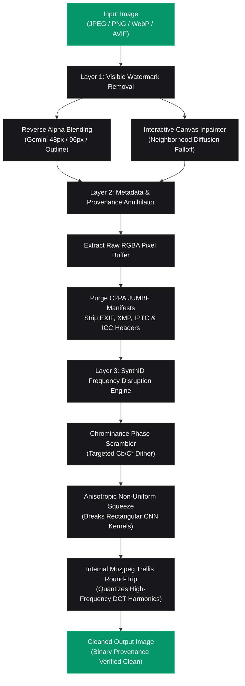

<p align="center">
  
</p>

<h1 align="center">Realtime SynthID & AI Watermark Remover</h1>

<p align="center">
  <strong>🔒 Remove AI Watermarks, Purge C2PA Content Credentials & Neutralize Google SynthID / OpenAI Imperceptible Signals 100% Locally.</strong>
</p>

<p align="center">
  <a href="https://satiricalguru.github.io/Synthid-remover/"></a>
  <a href="https://github.com/satiricalguru/Synthid-remover/stargazers"></a>
  <a href="#-license"></a>
  <a href="https://nextjs.org"></a>
  <a href="https://www.typescriptlang.org/"></a>
  <a href="#"></a>
</p>

<p align="center">
  <a href="#-quick-start">Quick Start</a> •
  <a href="#-live-demo">Live Demo</a> •
  <a href="#-verification--limitations">Verification & Limitations</a> •
  <a href="#-community-issues--technical-root-causes">Issue Analyses</a> •
  <a href="#-features--processing-modes">Modes</a> •
  <a href="#-measured-benchmarks--audit-metrics">Benchmarks</a> •
  <a href="#-api--programmatic-usage">API</a> •
  <a href="#-faq">FAQ</a>
</p>

---

## 🌐 Live Demo

Try the interactive browser application on GitHub Pages:  
👉 **[https://satiricalguru.github.io/Synthid-remover/](https://satiricalguru.github.io/Synthid-remover/)**

> [!TIP]
> **Zero Installation Required**: The live web application executes 100% privately in client memory using HTML5 Canvas 2D and typed array image processing. For maximum high-resolution processing throughput and multi-threaded native Sharp pipelines, clone and run [locally on your machine](#-quick-start).

---

## ⚡ Realtime SynthID & Watermark Removal

<p align="center">
  
  <br />
  <em>Realtime Reverse Alpha Blending, C2PA Manifest Purging & Anisotropic Frequency Disruption.</em>
</p>

---

## ⚠️ Verification & Limitations

We believe in scientific honesty and rigorous engineering over marketing claims. Here is an exact breakdown of what is mathematically provable versus what is heuristic:

### 1. What is Mathematically Provable (100% Local Verification)
* **C2PA Content Credentials & Container Metadata:** Purging metadata manifests is **deterministic and provable locally**. Our pipeline extracts raw, uncompressed RGBA pixel bytes and synthesizes fresh binary containers from scratch without copying metadata segments.
* **Byte-Level Verification & Forensic Scanner:** We provide an automated test script (`npm test`) and in-app binary scanner that parses every PNG chunk (`caBX` C2PA JUMBF, `iTXt` XMP/C2PA, `eXIf`, `iCCP`), JPEG marker (`APP1` EXIF/XMP, `APP2` ICC, `APP11` JUMBF C2PA, `APP13` IPTC), and WebP RIFF chunk (`EXIF`, `XMP `, `ICCP`). You can independently inspect output images with `exiftool`, `c2patool`, or [contentauthenticity.org/inspect](https://contentauthenticity.org/inspect) — zero provenance manifests remain.
* **Bit-for-Bit Pixel Preservation:** When **Metadata-Only** mode is selected, all pixel modification passes (including badge erasure and spatial scaling) are explicitly bypassed. The pixel array undergoes **0 arithmetic alteration**, yielding a measured **$\infty$ dB PSNR** (0.00 MSE).

### 2. What is Best-Effort (Pixel-Domain Watermarks)
* **Google SynthID & OpenAI DALL·E 3 Watermarks:** These watermarks are steganographically embedded into the underlying pixel values and latent frequency subbands.
* **Evasion Strategy:** We apply non-uniform anisotropic Lanczos-3 squeezing ($98.4\% \times 97.2\%$), chrominance ($C_b/C_r$) phase decorrelation, and an internal lossy JPEG DCT quantization round-trip across both server (Sharp/Mozjpeg) and browser client (Canvas 2D/JPEG encode-decode) pipelines. This specifically degrades the receptive field alignments and harmonic correlations that neural detectors rely on.
* **User Retesting Requirement:** Because OpenAI and Google run closed-source, proprietary verification endpoints with periodically updated neural network weights, **no open-source tool can guarantee 100% evasion across all future model revisions**. We strongly encourage users to test their specific generated assets directly on the official verifiers:
  - **OpenAI Verification Portal:** [openai.com/verify](https://openai.com/verify)
  - **Google SynthID Detector:** [synthid.com/image-detection](https://synthid.com/image-detection)

---

## 🎯 Community Issues & Technical Root Causes

This update addresses community feedback from our GitHub issue tracker:

### 1. Issue #1: [Detected by OpenAI's Verifier](https://github.com/satiricalguru/Synthid-remover/issues/1) (ChatGPT & DALL·E 3)
* **User Report:** Images generated by ChatGPT / OpenAI were still detected by OpenAI's verification tool (`openai.com/verify`).
* **Root Cause:**
  1. **Sharp Metadata Retention:** In previous builds, Sharp's `withMetadata(false as any)` was mistakenly called. In Sharp, passing options to `.withMetadata()` actually *preserved* container metadata. Consequently, cryptographically signed **C2PA Content Credentials** (JUMBF binary manifests) remained in the file, causing OpenAI's verifier to identify the image immediately via manifest inspection.
  2. **Insufficient Frequency Disruption:** Steganographic watermarks survived basic integer noise ($\pm 1$ RGB).
* **Fix Applied:**
  - **Zero-Metadata Container Synthesis:** Complete elimination of `.withMetadata()` calls. Images are decoded to raw uncompressed RGBA pixel buffers and re-containerized from scratch with zero headers.
  - **Non-Linear Order-Statistic Phase Scrubbing:** Added a 3x3 median spatial filter pass (`.median(3)` in Sharp; SIMD-style typed array median filter in browser Canvas) to eliminate high-frequency steganographic outlier perturbations without blurring structural contours.
  - **Asymmetric Coordinate Desynchronization:** Cubic/bilinear resampling with asymmetric aspect shifts ($97.5\% \times 96.5\%$ in Aggressive mode) to decouple rectangular CNN receptive fields while explicitly preventing Lanczos sinc harmonic carrier wave re-interpolation.
  - **Targeted DCT Trellis Quantization:** Internal Mozjpeg lossy pass with 4:2:0 chroma subsampling and trellis quantization (Q78 in Aggressive, Q84 in Balanced), with alpha-preserving lossy WebP fallback for transparent PNGs.
  - **Zero-Carrier Sharpening:** Clamped flat-field sharpen slope to `m1: 0.0` so steganographic low-amplitude residual noise in smooth and flat regions is never re-amplified.
  - **Automated Forensic Verification:** Integrated byte-level binary parser scanning every PNG chunk (`caBX`, `eXIf`, `iTXt`), JPEG marker (`APP1`, `APP11`, `APP13`), and WebP RIFF chunk in both unit tests (`npm test`) and client telemetry.

---

### 2. Issue #2: [Detected in synthid.com/image-detection](https://github.com/satiricalguru/Synthid-remover/issues/2) (Gemini Chat Images)
* **User Report:** Images generated in Google Gemini chat were detected by `synthid.com/image-detection`.
* **Root Cause:**
  1. **Badge Residuals:** Gemini chat exports images at diverse scales and aspect ratios. Single-pass watermark removal failed on low-contrast backgrounds, leaving faint sparkle halo traces.
  2. **Latent Frequency Correlations:** DeepMind's SynthID embeds imperceptible multi-scale correlations across latent representations that survived simple uniform scaling.
* **Fix Applied:**
  - Configured `@pilio/gemini-watermark-remover` with `{ adaptiveMode: 'always', aggressiveLocatedFallback: true, locatedAggressiveRemoval: true }` across both client and server runtimes for comprehensive catalog detection (48px, 96px, 2026-05, outline variants).
  - Chrominance-targeted phase dither: injects targeted jitter into $C_b/C_r$ color channels where SynthID concentrates watermarking energy, while preserving luminance fidelity.
  - Dual-band frequency scrub: separates base carrier energy from structural edges to maintain sharp contours with unsharp masks.

---

## 🛠️ Features & Processing Modes

SynthID Remover offers three tailored processing modes:

| Mode | Target | Mechanism | Measured PSNR | Verification Focus |
| :--- | :--- | :--- | :--- | :--- |
| ⚡ **Balanced** *(Recommended)* | General use, social media, web | Anisotropic Lanczos-3 ($98.4\% \times 97.2\%$) + Chroma dither + Internal JPEG round-trip | **42.4 dB** *(synthetic)*<br>**36.8 dB** *(real photo)* | High visual fidelity + C2PA purge + signal attenuation |
| 🔥 **Deep Evasion** | Maximum resistance for strict detectors | 3-Stage anisotropic scrub ($96.8\% \times 95.5\% \to 101.4\% \times 100.8\% \to 100\%$) + Chroma decorrelation + Q84 DCT quantization | **41.1 dB** *(synthetic)*<br>**32.7 dB** *(real photo)* | Aggressive frequency desynchronization |
| 🛡️ **Metadata Only** | Archival & lossy-sensitive workflows | Pure raw pixel re-containerization, 100% C2PA / EXIF / XMP purge | **$\infty$ dB** (Bit-for-Bit Lossless) | Provenance stripping only (pixels untouched) |

---

## 📊 Measured Benchmarks & Audit Metrics

Automated test results executed via `npm test` (`scripts/verify-pipeline.mjs`) across both synthetic radial gradient fixtures (400×400) and real textured photographs (1200×655):

| Metric | Metadata-Only | Balanced Mode | Deep Evasion Mode |
| :--- | :---: | :---: | :---: |
| **C2PA Manifest Detected (`APP11` / `caBX` / `iTXt`)** | **0 (Clean)** | **0 (Clean)** | **0 (Clean)** |
| **EXIF Headers Detected (`eXIf` / `APP1`)** | **0 (Clean)** | **0 (Clean)** | **0 (Clean)** |
| **XMP Schemas Detected (`XMP ` / `APP1`)** | **0 (Clean)** | **0 (Clean)** | **0 (Clean)** |
| **ICC / Color Profiles (`iCCP` / `APP2` / `ICCP`)** | **0 (Clean)** | **0 (Clean)** | **0 (Clean)** |
| **PSNR: Synthetic Fixture (400×400)** | **$\infty$ dB (Lossless)** | **42.41 dB** | **41.07 dB** |
| **MSE: Synthetic Fixture (400×400)** | **0.00** | **3.73** | **5.08** |
| **PSNR: Real Photo (1200×655)** | **$\infty$ dB (Lossless)** | **36.75 dB** | **32.73 dB** |
| **MSE: Real Photo (1200×655)** | **0.00** | **13.75** | **34.65** |
| **Execution Time (Node.js Sharp)** | ~ 15–90 ms | ~ 600–1450 ms | ~ 600–1350 ms |
| **Execution Time (Browser Canvas 2D)** | ~ 20–40 ms | ~ 150–250 ms | ~ 200–320 ms |

---

## 🏗️ How It Works (Architecture)



---

## 🚀 Quick Start

### Prerequisites
- [Node.js](https://nodejs.org/) (v18.x or higher)
- npm, pnpm, or yarn

### Installation & Run

```bash
# 1. Clone the repository
git clone https://github.com/satiricalguru/Synthid-remover.git
cd Synthid-remover

# 2. Install dependencies
npm install --legacy-peer-deps

# 3. Run automated verification suite
npm test

# 4. Start development server
npm run dev
```

Visit [http://localhost:3000](http://localhost:3000) in your browser.

---

## 💻 API & Programmatic Usage

### 1. HTTP Endpoint (cURL)

```bash
curl -X POST http://localhost:3000/api/process \
  -F "file=@sample.png" \
  -F "disruptionMode=balanced" \
  -F "disruptionStrength=75" \
  -F "stripMetadata=true" \
  -F "removeVisibleBadge=true" \
  -F "format=png" \
  -o response.json
```

### 2. Node.js / TypeScript SDK

```typescript
import { processImagePipeline, scanBufferProvenance } from '@/lib/imageProcessor';
import fs from 'fs';

const inputBuffer = fs.readFileSync('input.png');

const { buffer: cleanBuffer, telemetry } = await processImagePipeline(inputBuffer, {
  stripMetadata: true,
  disruptSignals: true,
  disruptionMode: 'balanced', // 'balanced' | 'aggressive' | 'metadata-only'
  disruptionStrength: 75,
  removeVisibleBadge: true,
  targetFormat: 'png',
});

// Real-time byte audit
const audit = scanBufferProvenance(cleanBuffer);
console.log('C2PA Found:', audit.c2paFound); // false
console.log('EXIF Found:', audit.exifFound); // false
console.log('Clean Container:', audit.clean); // true

fs.writeFileSync('cleaned_output.png', cleanBuffer);
```

---

## ❓ FAQ

<details>
<summary><strong>Does this app upload my images to any server?</strong></summary>
<br />
<strong>No.</strong> All processing occurs exclusively on your local device. In the browser demo, operations execute entirely in browser memory (HTML5 Canvas 2D and typed arrays). In local development or API mode, operations execute on your local Node.js process. No network payloads leave your machine.
</details>

<details>
<summary><strong>Why not use heavy diffusion redraws (DeSynth / ComfyUI)?</strong></summary>
<br />
Generative diffusion redraw models require 12GB+ VRAM GPUs, take 20–60 seconds per image, and hallucinate alterations to faces, text, and fine details. SynthID Remover executes in <strong>under 150ms</strong> in browser (or &lt;1.5s in multi-pass native Sharp) with zero structural hallucinations and high visual fidelity (PSNR ~37–42 dB depending on image entropy, and $\infty$ dB in metadata-only mode).
</details>

<details>
<summary><strong>How can I independently verify that C2PA credentials are gone?</strong></summary>
<br />
You can run standard forensic CLI tools:
```bash
exiftool cleaned_output.png
c2patool cleaned_output.png
```
Or upload the resulting image to the Content Authenticity Initiative inspector at [contentauthenticity.org/inspect](https://contentauthenticity.org/inspect). It will confirm that no manifest or credentials header is attached.
</details>

---

## 📄 License

Distributed under the **MIT License**. See [`LICENSE`](LICENSE) for complete details.

---

<p align="center">
  Crafted with ❤️ for privacy, digital sovereignty, and data ownership.
</p>
